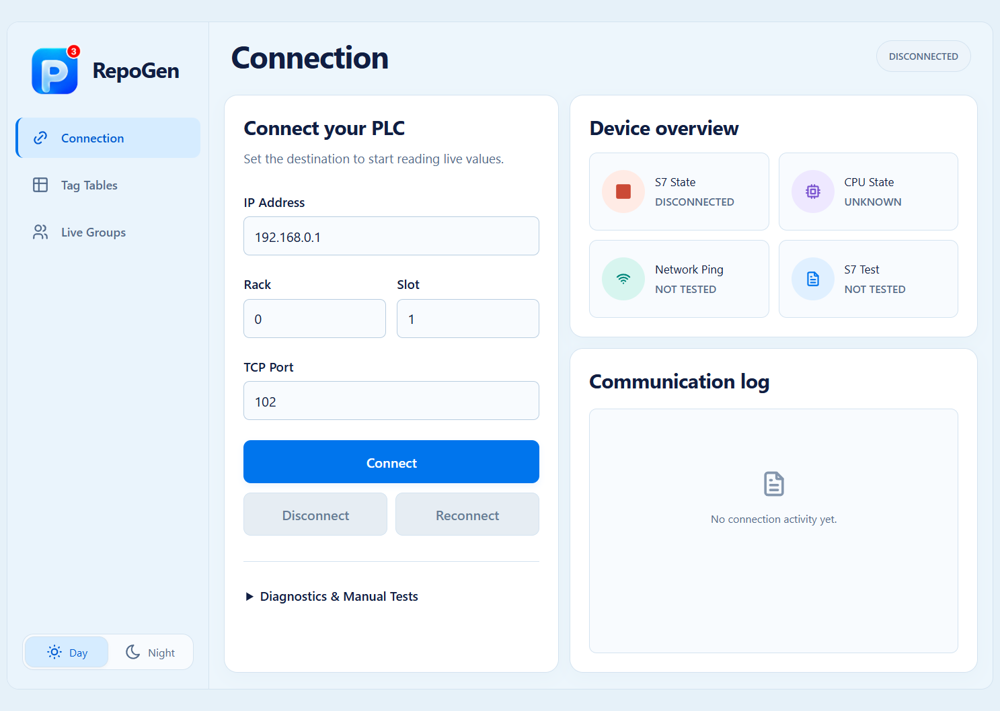
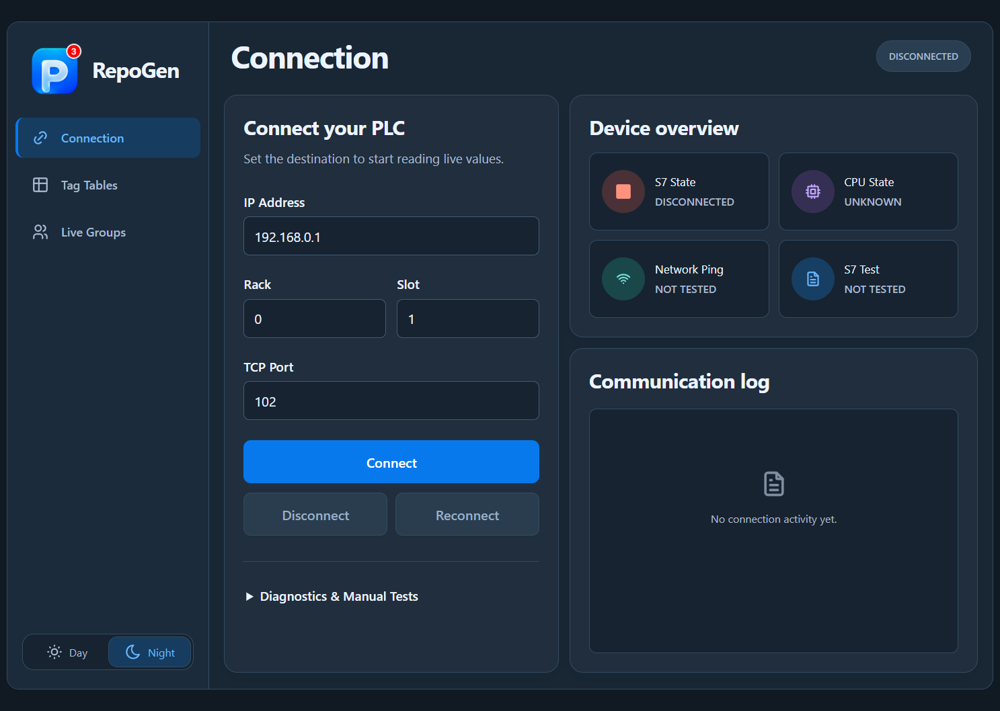

# RepoGen S7 — v1.3.0

RepoGen is a Windows desktop application for Siemens S7 PLC connection diagnostics, tag tables, verified value writes, and saved live monitoring groups. Python, SQLite and pywebview power the existing app; the frontend is HTML, CSS and JavaScript.

## Updated interface

### Day mode


### Night mode


Both themes use the same layout and controls; only colors change. Screenshots show the actual frontend with no connection activity, not fabricated live readings.

## All changes delivered

### Summary of Edits and Audits Completed in Codex

During the Codex development and testing sessions, the RepoGen S7 application was comprehensively audited, refactored, and enhanced across its communication layer, persistence architecture, and frontend user experience:

1. **S7 Protocol & Communication Layer Fixes**:
   - **BOOL Write Normalization**: Fixed a critical bug where writing `"false"` or `"0"` evaluated to `True` via Python's native `bool(value)`. Implemented explicit boolean normalization (accepting case-insensitive `"true"`, `"false"`, `"1"`, `"0"` with whitespace stripping) and bit-level read-modify-write masking to preserve neighboring memory bits in S7 memory areas (DB, M).
   - **Transport Loss Detection & Auto-Recovery**: Resolved an issue where a severed network socket left the UI displaying a stale green `CONNECTED` status. `s7_client.py` now monitors transport health, clears internal connection flags on socket exceptions, reports `CONNECTION LOST`, and initiates a throttled automatic reconnect cycle.
   - **SZL CPU-State Query Decoupling**: Unsupported SZL queries (`0x8104` / `0x8404` on certain PLCs and simulators) are now gracefully handled as `UNKNOWN — CPU state unavailable` rather than treating diagnostic limits as fatal socket drops.
   - **Strict Float32 Rounding & Equality**: Replaced loose float comparisons with true IEEE 754 single-precision packing via `struct.pack(">f", ...)` to prevent precision drift on large floating-point numbers, and rejected non-finite values (`NaN`, `Infinity`).

2. **Persistence & Concurrency Hardening**:
   - **Database Path Anchor (`repogen.db`)**: Fixed database disappearance when launching RepoGen from desktop shortcuts or foreign working directories by dynamically anchoring `DB_PATH` next to `sys.executable` (when frozen) or the project root (when running from source).
   - **Reconnect Race Condition Prevention**: Added `generation` counters and `operation_lock` mutexes in `PLCManager` so obsolete background reconnect loops are immediately invalidated when a user explicitly clicks **Disconnect**.
   - **Stale Data Integrity (`mark_stale`)**: Replaced misleading fresh-data displays and empty `"---"` dashes with explicit amber `STALE` tags and last-known timestamps whenever monitoring is paused or disconnected.
   - **Relational Groups & Cascade Deletions**: Designed atomic SQLite schemas for custom tag groups (`groups`, `group_tags`, `preferences`), ensuring that deleting a group leaves original tags untouched, while deleting an original tag cleanly cascades.

3. **UI/UX Transformation & Accessibility Overhaul**:
   - **Tokenized Design System**: Eliminated transparent dialog bleed-through by unifying CSS variables into solid, opaque dark (`#141518` background, `#202228` cards) and light (`#f6f8fa`) palettes with 8px corner radii, 24px internal padding, and dimmed overlays.
   - **Responsive Workspace**: Replaced crowded horizontal tabs with a clean sidebar and responsive layouts: a two-column view (sidebar + data table) for wide viewports (≥1000px) and a compact dropdown for narrow viewports (<1000px), fully functional at 800×600 minimum size.
   - **Accessible Modals**: Implemented focus trapping (`Tab` / `Shift+Tab`), `Escape` key dismissal, accessible ARIA labels, and explicit `for`/`id` input bindings.
   - **Write Value Modal Safety**: Added type-specific controls (discrete toggle switches for BOOLs, min/max bounds for integers/floats) and in-flight write locking (`isWriteInFlight`) to prevent duplicate packet submission.
   - **Pywebview Bridge Guard**: Implemented `waitForApi()` with temporary control disabling to prevent runtime JavaScript errors when clicking buttons before `window.pywebview.api` finishes mounting.

4. **Live Groups & Real-Time Trend Charts (v1.2.0 - v1.3.0)**:
   - Added cross-table multi-tag grouping from Tag Tables via **Group selected tags**.
   - Created the dedicated **Live Groups** workspace with real-time SVG sparklines: discrete square-wave pulses for BOOL states and rolling continuous curves with dynamic Min/Max scaling for numeric values.
   - Integrated full Day/Night theme switcher with instant switching and local SQLite preference persistence.

---

### v1.3.0 — Branded workspace and final fixes

- Added the supplied blue P logo, including its red 3 artwork. It is a brand image, not a live notification count.
- Replaced the top tabs with a persistent sidebar for **Connection**, **Tag Tables**, and **Live Groups**; the page heading follows the selected section.
- Rebuilt Connection around a PLC form, a two-by-two Device overview, and a separate Communication log.
- Applied consistent spacing, rounded cards, native Segoe UI typography, blue primary actions and quieter secondary/disabled controls across screens and dialogs.
- Added explicit **Day / Night** controls at the bottom of the sidebar, with saved theme preference and identical geometry in both themes.
- Preserved the existing Connect, Disconnect, Reconnect, Ping and S7 diagnostic actions; manual tests remain in an expandable section.
- Added keyboard arrow/Home/End navigation for the main tabs; retained visible focus, modal focus trapping, Escape dismissal and reduced-motion support.
- Adapted the layout to the supported 800 × 600 minimum window; compact windows stack panels and use a table selector. Adjusted the compact breakpoint to prevent cramped status text.
- Set the initial desktop window to 1280 × 900 and updated the application/build version to 1.3.0.
- Preserved connection **slot 0**, which previously became 1 through a JavaScript fallback.
- Applied required-field and numeric-range validation before connection/diagnostic requests.
- Prevented a delayed saved-theme response from overwriting a theme selected during startup.
- Fixed paused group cards changing values while table monitoring continued. They now retain the displayed reading and timestamp until resumed.
- Corrected the group-dialog closing markup and included the brand/icon assets in the packaged app. Tabler icons retain their [MIT license](frontend/assets/icons/LICENSE).
- Kept simulation data and controls out of the normal application. Existing tables, tags and preferences use the existing database.

### v1.2.2 — Clearer live status and graph controls

- Added resolved PLC addresses and explicit ON/OFF display for BOOL tags.
- Added chart axes, time range and sample-count information.
- Made LIVE, PAUSED and DISCONNECTED states explicit, with stale-quality messaging.
- Moved group deletion into **More**, alongside a confirmation explaining that source tags remain.

### v1.2.1 — Live trend charts

- Added numeric line charts and BOOL step charts using real sample timestamps.
- Retained up to 120 recent samples per chart in the current session; history is not a persistent historian.
- Paused graphs stop advancing; unavailable readings create gaps rather than false continuous lines.
- Kept group readings available when moving between screens and removed a redundant refresh after saving a group.

### v1.2.0 — Saved groups and theme persistence

- Added tag-selection checkboxes and **Group selected tags** in Tag Tables.
- Added the Live Groups screen with group selection, creation, naming, customization, and start/pause controls.
- Allowed group members from multiple tag tables; membership can be added or removed without duplicating original tags.
- Added SQLite tables for groups, memberships and preferences, plus backend group/theme APIs.
- Group deletion preserves original tags. Deleting an original tag removes its group memberships.
- Integrated group monitoring with the existing polling loop, independently of the active table.
- Switching groups pauses the previous group; leaving the screen keeps the selected live view running.

### Earlier communication, stability and UI fixes retained

| Issue | Implemented behavior |
| --- | --- |
| Text such as `"false"` or `"0"` became true during BOOL writes | Explicit boolean normalization; bit writes preserve neighboring bits through read-modify-write. |
| Connected status remained after transport failure | Transport failures clear connection state and the manager handles recovery. |
| Unsupported CPU-state diagnostics interrupted usable connections | CPU-state unavailability is reported separately while a working data connection remains usable. |
| REAL readback compared inconsistent float precision | Values are encoded as float32 for verification; invalid/non-finite inputs are rejected. |
| Saved data appeared missing when launched from another working directory | The database path is anchored to the source root or packaged executable directory. |
| Automatic reconnect could outlive a manual disconnect | Generation counters and operation locks invalidate obsolete reconnect attempts. |
| Repeated clicks queued duplicate writes | An in-flight write lock prevents duplicate submissions and input changes during the write. |
| Controls ran before the desktop bridge was ready | The frontend waits for the actual pywebview bridge and temporarily disables controls. |
| Old readings looked fresh after stop/disconnect | Retained data is marked STALE with last-read information. |
| Dialog content was transparent or cramped | Opaque themed cards, dimmed backdrops and scrollable bodies keep dialog actions readable and reachable. |
| Dense table controls obscured routine actions | Expandable tag details and table options reduce clutter. |

## Use Live Groups

1. Open **Tag Tables**, choose a table, and select the tags you want.
2. Choose **Group selected tags**, enter a name, and save.
3. In **Live Groups**, select the saved group and choose **Start live view**.
4. Use **Customize** to rename it or add/remove members, including tags from other tables.
5. Use **Pause live view** to retain the last displayed readings and graph. **More → Delete group** removes only the group.

Groups provide read-only monitoring; writes remain in the existing Tag Tables write dialog. Day/night preference and group definitions persist, while chart history is session-only.

## Run from source

Use Python 3.12 on Windows and an available Microsoft Edge WebView2 runtime.

```powershell
python -m venv .venv
.\.venv\Scripts\Activate.ps1
python -m pip install python-snap7 pywebview
python main.py
```

## Build the desktop app

```powershell
python -m pip install pyinstaller
python -m PyInstaller --noconfirm RepoGen-S7-v1.3.0.spec
```

Output: `dist/RepoGen-S7-v1.3.0.exe`. The spec bundles the frontend, logo and icon assets. Built executables are generated locally and are not stored in Git.

## Data and upgrade behavior

- Source runs use `repogen.db` in the project root; packaged runs use `repogen.db` beside the executable.
- Existing tables/tags are retained; group and preference tables are created if missing.
- Keep the executable beside the existing database to continue using that data. Back up the database before relocating an installation.
- Runtime logs, databases, generated test screenshots and temporary test directories are excluded from Git. The README screenshots are deliberate documentation assets.

## Verification performed

| Area | Result and scope |
| --- | --- |
| Python regression checks | 4 group tests and 9 existing regression tests passed, plus targeted REAL readback and reconnect checks. |
| Bridge and write concurrency | Existing JavaScript regressions passed for duplicate writes, waiting for the bridge and restoring disabled states. |
| Connection workflow | Connect/reconnect/disconnect, slot 0, ping and S7 diagnostic controls passed using simulated transport. |
| Tag tables and writes | Table/tag creation, editing and deletion, monitoring, out-of-range INT rejection, and simulated write/readback passed. |
| Live Groups | Selection, creation, cross-table membership edits, rename, save/reload, and deletion preserving source tags passed. |
| Live charts | Changing values/paths, pause/resume gaps, disconnected/stale status, and pause while table monitoring continues passed. |
| Themes and window sizes | Saved theme and matching day/night geometry passed; layouts checked at 1487 × 1058, 1280 × 900 and 800 × 600. |
| Dialogs and browser errors | Compact group-dialog actions and Escape dismissal passed; tested browser flows produced no uncaught JavaScript errors. |
| Windows package | v1.3.0 built successfully and was opened for a desktop startup/visual smoke test. |

Testing used a temporary SQLite database and mocked PLC transport; no test writes were sent to real hardware. Real PLC compatibility, long-duration monitoring, and every Windows display-scaling combination remain unverified for this release. Passing these checks is not a guarantee that every possible issue has been eliminated.

### Repeat the offline checks

```powershell
python work/test_groups.py
python work/review_checks.py
node work/frontend_regressions.cjs
```

Browser tests require Node.js 20+, Playwright and Microsoft Edge. Install Playwright in your test environment, for example with `npm install --no-save --package-lock=false playwright`.

Start a fresh server for each independent browser suite. Run the server in one terminal and the test in another; stop it with Ctrl+C afterward.

| Test | Server command | Test command |
| --- | --- | --- |
| Groups and charts | `python work/group_ui_server.py` | `node work/group_ui_test.cjs` |
| Connection/tag/write workflow | `python work/group_ui_server.py --disconnected` | `node work/workspace_ui_test.cjs` |
| Theme/layout screenshots | `python work/group_ui_server.py --disconnected` | `node work/capture_workspace.cjs` |

The UI test server serves the actual frontend and service/database with an injected test bridge. It listens on loopback and uses mocked PLC clients. These test-only hooks are not included in the production frontend.

`test_snap7.py` is a hardware-oriented integration script and is not part of the offline commands above; inspect its target and writes before running it.

## Source map

- `backend/`: PLC client/manager, codecs, database, polling, write verification and frontend service API.
- `frontend/`: production interface; `workspace.css` holds the approved shell and theme tokens, `groups.js` handles group UI/charts.
- `frontend/assets/`: brand logo and licensed Tabler icons.
- `work/`: repeatable offline regression tests and isolated browser harness.
- `docs/screenshots/`: day/night screenshots for this README.
- `main.py` and `RepoGen-S7-v1.3.0.spec`: desktop entry point and current package definition.
- `design-qa.md`: design comparison and validation notes from this release. Original mockup paths refer to local design-session evidence.
- `PROJECT_STATUS.md`: historical investigation notes from older builds; use this README for the current release and test limits.
